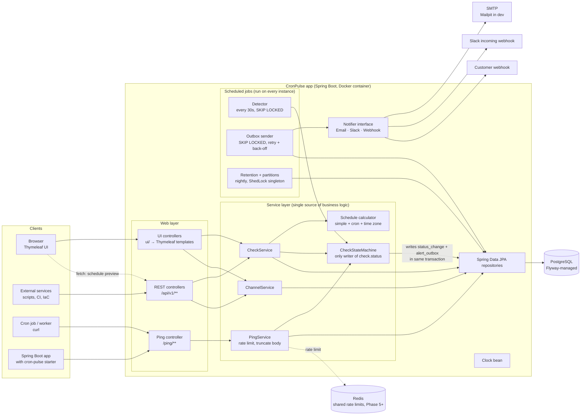
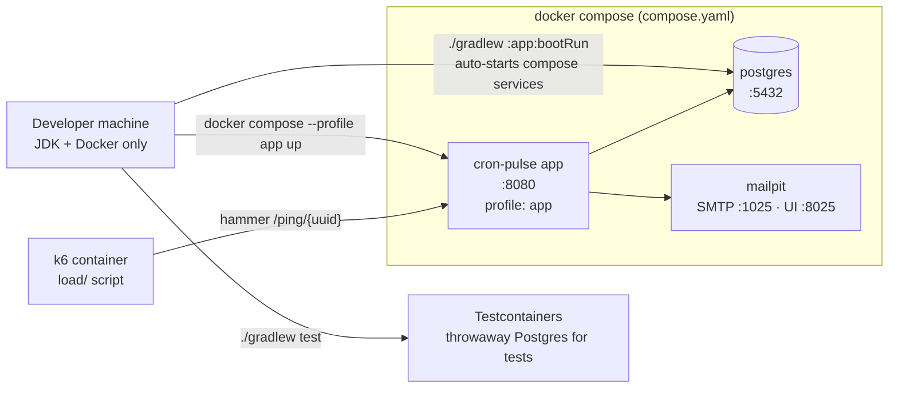
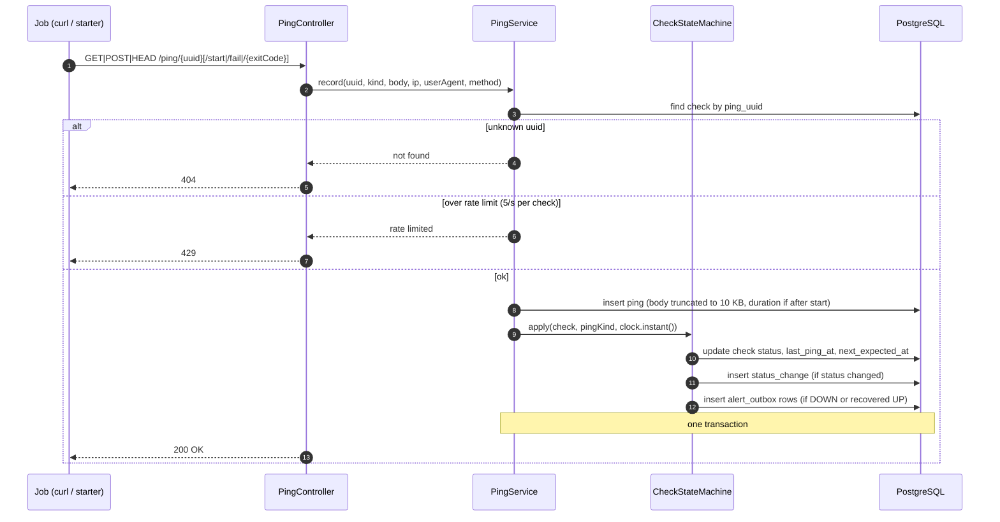
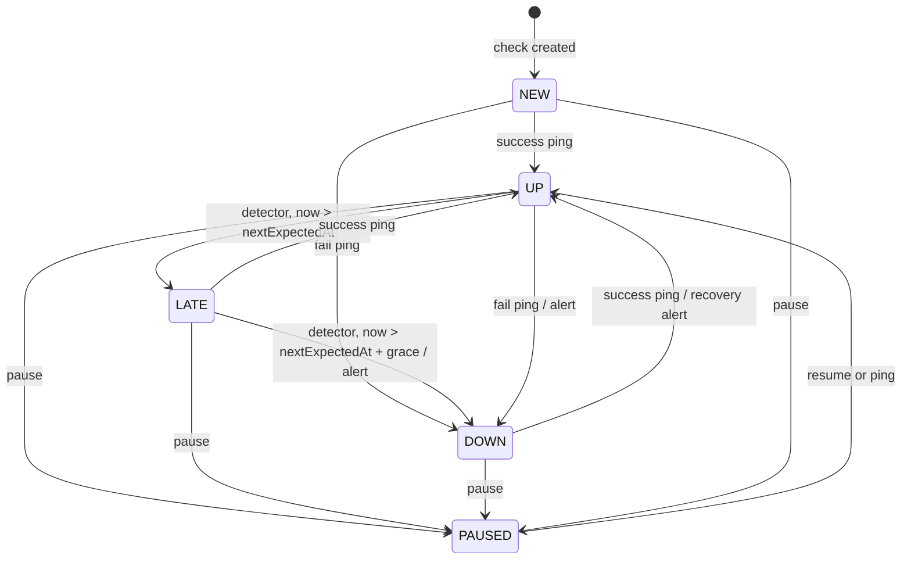
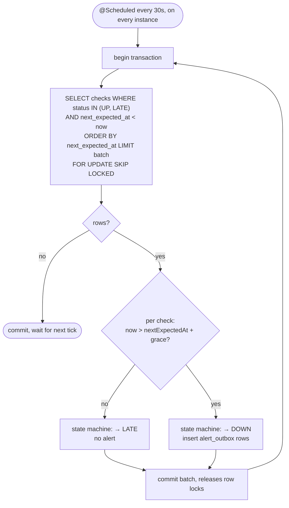
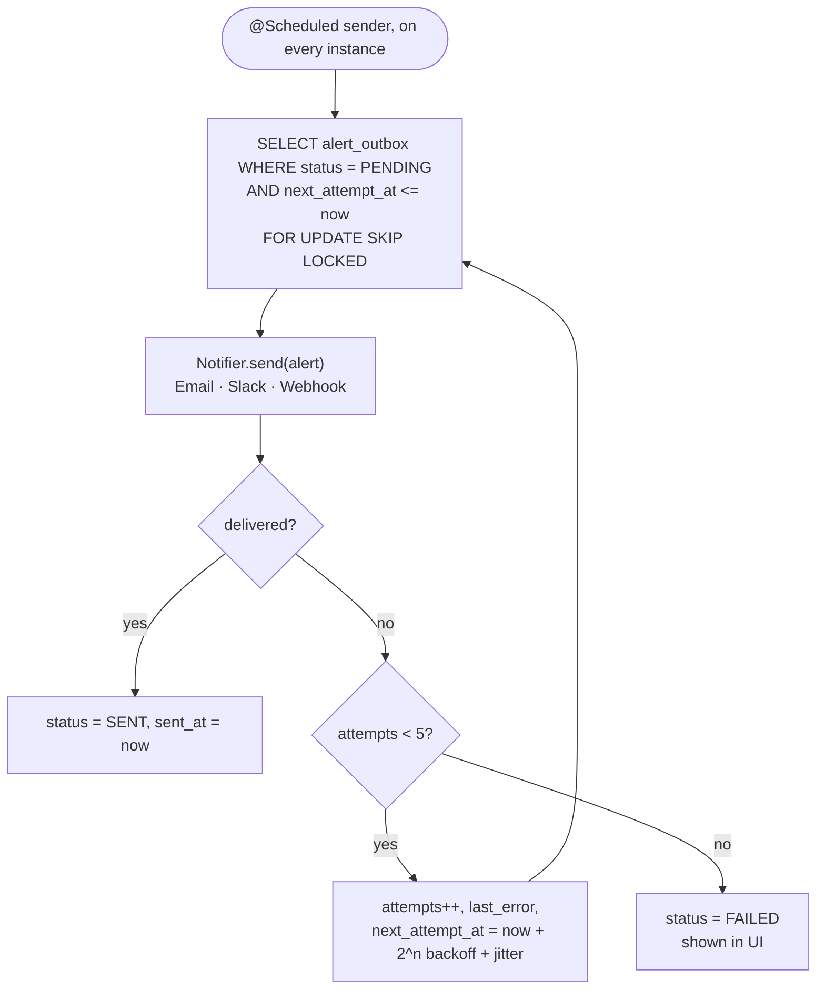
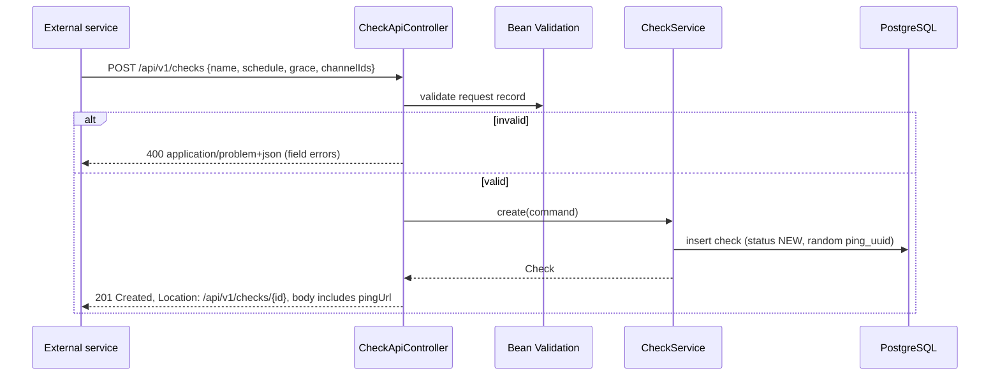
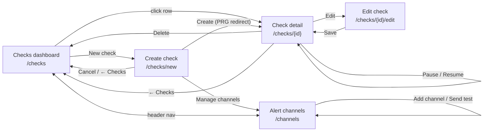

# CronPulse

> Heartbeat monitoring for cron jobs and background workers. A standalone Spring Boot application, designed to enterprise standards and built to scale.
> This file is the build brief for Claude Code. Read it fully before writing code.
> The phase-by-phase plan (scope, Definition of Done, learning takeaways, scale targets) is in [`docs/planning/ROADMAP.md`](docs/planning/ROADMAP.md). **Always check which phase is current before writing code, and stay within its scope.**

## 0. Why this project exists

The **primary purpose** of this project is to **build in public and share the learnings**. The process of building it, the decisions made, and the mistakes fixed are documented so other engineers can learn how to build a reliable, **enterprise-grade, horizontally scalable** backend service in Java. Each phase becomes one story in the Medium series *Building CronPulse: An Enterprise-Grade Heartbeat Monitor in Spring Boot*. The product is the vehicle; the learning is the point. Deeper material lives on [codefarm.in](https://codefarm.in).

This shapes how the code is written:
- Favour clarity over cleverness. A learner should understand any class on first read.
- Comment the **why** behind non-obvious decisions, not the what.
- Build in small, self-contained steps, with one concept per commit where practical and clear commit messages.
- Work in **phases** (section 9). Each phase is built on a branch `phase/N-slug`, merged when its Definition of Done is met, and tagged `phase-N` so readers can check out the code for each story.
- During each phase, keep `docs/learnings/phase-N-<slug>.md` up to date (from `docs/learnings/_TEMPLATE.md`): what was built, the key concept, **what went wrong and how it was fixed**, trade-offs, and measured numbers. This note is the Medium story draft.
- Record decisions with real trade-offs as ADRs in `docs/adr/NNNN-title.md`.
- When a phase finishes, update its status in `README.md` and `docs/planning/ROADMAP.md`.

### Key takeaways for learners

Someone who follows this project end to end will learn:

**Reliability engineering in a real service**
- The **dead man's switch** pattern: alerting on the *absence* of a signal, not its presence
- Modelling a **state machine** (NEW → UP → LATE → DOWN → UP, plus PAUSED) and keeping transitions in one place
- Working with **time correctly**: cron expressions, time zones, daylight saving, grace periods, and an injectable `Clock` so time-based logic is testable
- Running **scheduled work safely across several app instances**: sharing work with `SELECT … FOR UPDATE SKIP LOCKED`, and ShedLock for true singletons
- **Multi-tenancy and security**: organisations as tenants, isolation proven by tests, hashed and scoped API keys, audit logs
- **Scaling with measurements**: load tests, partitioned tables, distributed rate limiting, connection pool sizing
- Sending alerts **at least once without spamming**: an outbox table, retries with back-off, and de-duplication
- Designing a **high-volume, unauthenticated ingest endpoint**: fast path, unguessable IDs, size limits, and rate limiting

**Backend engineering with Spring Boot**
- Package-by-feature architecture
- Spring Data JPA with PostgreSQL, and schema migrations plus seed data with Flyway
- Data retention: trimming old pings so tables don't grow forever
- Pluggable integrations behind one interface (email, Slack, generic webhook)
- Profiles and externalised configuration, with secrets kept out of the repo
- Designing a **versioned REST API** (`/api/v1`) with DTOs, validation, consistent error responses (`ProblemDetail`), pagination, and OpenAPI docs, so any external service can integrate
- Running everything in **Docker**: Docker Compose for Postgres + Mailpit in dev, and a containerised app image
- Observability with Actuator, Micrometer and OpenTelemetry, with logs, metrics and traces in **OpenObserve**: monitoring the monitor
- Testing: unit tests with a fixed `Clock`, `MockMvc` API tests, Testcontainers, and WireMock for outbound webhooks
- Writing a **Spring Boot starter** library that other apps add as one dependency
- A server-rendered UI with **Thymeleaf** that sits on top of the same services as the REST API, with no separate JavaScript frontend

**Product thinking**
- Competing in a proven market (Cronitor, Healthchecks.io) on simplicity and one ecosystem
- Scoping an MVP into phases that each ship something usable
- Preparing for free and paid plans (check limits, plan flags) before adding payments

## 1. What we are building

A service that tells you when a scheduled job **didn't run, ran late, or failed**.

1. A user creates a **check** for each job (e.g. "nightly-db-backup"), saying how often it should run.
2. CronPulse gives the check a unique **ping URL**.
3. The job calls that URL when it finishes (one line: `curl https://…/ping/<id>`), optionally also when it starts or fails.
4. If a ping doesn't arrive on time (plus a grace period), CronPulse marks the check **DOWN** and alerts the user by email, Slack, or webhook. When pings resume, it sends a **recovery** alert.

The differentiator: **first-class Spring Boot support**. A small starter library lets any Spring Boot app monitor its `@Scheduled` methods by adding one annotation, with no curl calls.

**API-first:** everything the UI can do (manage checks, channels, read pings and the status timeline) is also exposed as a JSON REST API, so other services, scripts, CI pipelines and infrastructure tools can create and manage checks programmatically. The Thymeleaf UI is just one client of the same service layer.

## 2. Project identity

| Field | Value |
|---|---|
| Product name | CronPulse |
| Group | `in.codefarm` |
| Artifact | `cron-pulse` |
| Base package | `in.codefarm.cronpulse` |
| Build | Gradle (Kotlin DSL, `build.gradle.kts`), multi-module |
| Java | Latest LTS supported by the chosen Spring Boot version (21 minimum) |
| Spring Boot | Latest stable from start.spring.io |

### Modules
- `app`: the CronPulse service (REST API, Thymeleaf UI, ping ingest, detector, alerts)
- `cron-pulse-spring-boot-starter`: the client library (Phase 4)

## 3. Tech stack

- **Spring Boot**: web (Spring MVC), validation, actuator, mail
- **REST API**: Spring MVC `@RestController`s under `/api/v1`, JSON request/response DTOs (Java records), Bean Validation, errors as RFC 9457 `ProblemDetail`, OpenAPI spec + Swagger UI via **springdoc-openapi**
- **UI**: **Thymeleaf** server-rendered templates (Spring MVC `@Controller`s), with a small amount of plain JavaScript only where needed (copy-to-clipboard, live schedule preview calling the REST API). No separate JS frontend, no build step for the UI.
- **Persistence**: Spring Data JPA + **PostgreSQL**, schema managed by **Flyway**
- **Scheduling**: Spring `@Scheduled` on every instance. Shared work queues (detector, outbox sender) claim rows with `SELECT … FOR UPDATE SKIP LOCKED` so all instances help without double-processing. **ShedLock** (JDBC) is only for true singletons (retention, partition maintenance).
- **Rate limiting**: Bucket4j, in-memory in Phase 2, backed by **Redis** from Phase 5 so limits hold across instances
- **Caching**: Caffeine for hot `ping_uuid → check` lookups
- **Observability** (Phase 3): **[OpenObserve](https://openobserve.ai/)** (OSS, self-hosted in Docker) stores and shows **logs, metrics and traces**, with dashboards and alerts. The app exports everything over **OTLP** to an **OpenTelemetry Collector**, which forwards to OpenObserve. Never couple app code to the backend.
  - metrics: Micrometer with `micrometer-registry-otlp`; traces: Micrometer Tracing with the OpenTelemetry bridge; logs: structured JSON (stdout) plus the OpenTelemetry Logback appender, carrying `trace_id`
  - dashboards and alerts live as JSON in `observability/openobserve/` and are imported on startup; OpenObserve credentials come from `.env`, never the repo
- **Cron parsing**: Spring's `CronExpression` (no extra library)
- **Virtual threads** enabled (`spring.threads.virtual.enabled=true`) for the ping endpoint and alert sending
- **Docker for all infrastructure**: nothing is installed locally except a JDK and Docker.
  - `compose.yaml` runs Postgres and Mailpit (plus Redis from Phase 5); Spring Boot Docker Compose support starts it automatically on `./gradlew :app:bootRun`
  - Extra compose profiles as phases need them: `scale` (3 app instances + nginx, Phase 5), `observability` (OpenObserve + OpenTelemetry Collector, Phase 3)
  - A `Dockerfile` (multi-stage, or `./gradlew :app:bootBuildImage`) builds the app image, and a compose profile (e.g. `docker compose --profile app up`) runs the full stack: app + Postgres + Mailpit
  - Testcontainers uses the same Docker daemon for integration tests
- **Testing**: JUnit 5, `MockMvc` / `@WebMvcTest` for REST and UI controllers, Testcontainers (Postgres), WireMock (Slack and webhook calls), a fixed `Clock`

### start.spring.io dependencies
Spring Web, Thymeleaf, Validation, Spring Data JPA, PostgreSQL Driver, Flyway Migration, Java Mail Sender, Docker Compose Support, Spring Boot Actuator, Testcontainers, Spring Boot DevTools.
Add manually: ShedLock (`shedlock-spring`, `shedlock-provider-jdbc-template`), Bucket4j, springdoc-openapi (`springdoc-openapi-starter-webmvc-ui`), WireMock (test). These are not in the Spring Boot BOM, so pin their versions in one place (a Gradle version catalog, `gradle/libs.versions.toml`).

(Spring Security is added in Phase 4: session login for the UI, hashed and scoped API keys for `/api/v1/**`, and organisation-based tenant isolation. Until then, a single "default organisation" resolver stands in, kept in one place so it's easy to replace.)

## 4. Architecture

### 4.1 System architecture



### 4.2 Local runtime (Docker)



### 4.3 Packages

```
in.codefarm.cronpulse
├── check/          # Check entity, schedule logic, state machine, CRUD service, CheckApiController + DTOs
├── ping/           # Ping ingest endpoint, Ping entity, ping log API, retention job
├── detector/       # Scheduled sweep that finds late/down checks
├── alert/          # AlertChannel, Notifier interface, outbox, senders, ChannelApiController + DTOs
│   ├── email/
│   ├── slack/
│   └── webhook/
├── user/           # simple user handling (auth later)
├── api/            # cross-cutting API concerns: global exception handler (ProblemDetail), paging, OpenAPI config
├── ui/             # Thymeleaf @Controllers and view models (templates live in src/main/resources/templates)
├── tenant/         # Organisation, membership, tenant context (enforced from Phase 4)
├── audit/          # audit log of changes (Phase 4)
└── config/         # Clock bean, ShedLock, async, cache, rate-limit, properties
```

Rules:
- Package by feature, not by layer.
- **One service layer, two front doors.** REST controllers (`/api/v1/**`) and Thymeleaf controllers (`/`, `/checks/**`, …) both call the same services. Business logic never lives in a controller, and neither kind of controller touches repositories directly.
- **Never expose JPA entities over the API.** Map to request/response DTOs (records). The API contract must not change because an entity changed.
- REST controllers return JSON only; Thymeleaf controllers return view names only. Don't mix them in one class.
- **Time comes from an injected `java.time.Clock` bean everywhere.** Never call `Instant.now()` directly. Tests use a fixed or mutable clock.
- **All state transitions go through one class** (e.g. `CheckStateMachine`). Nothing else sets `check.status`.
- **All alert channels implement one `Notifier` interface.** Adding Telegram or PagerDuty later means adding one class.
- Store all instants in UTC (`timestamptz`). Convert to the check's time zone only for cron evaluation and display.

### 4.4 Key flows

**Ping ingest.** The hot path. It does as little as possible and never sends an alert inline.



**Check states.** Every arrow is implemented in `CheckStateMachine` and recorded as a `StatusChange`.



**Detector sweep.** Runs on every instance; `SKIP LOCKED` hands each instance a different batch, so they share the work and never process the same check twice.



**Alert delivery (outbox).** At least once, never inline, no spam.



**Management via REST API.** The UI and external services go through the same service layer.



## 5. Core behaviour

### 5.1 Schedules
A check has one of two schedule types:
- **Simple:** "every N minutes/hours/days" (`period`), e.g. every 1 hour.
- **Cron:** a cron expression plus a time zone, e.g. `0 2 * * *` in `Asia/Kolkata`.

Plus a **grace period** (e.g. 15 minutes): how late a ping can be before the check goes DOWN.

`nextExpectedAt` is computed after every ping:
- Simple: `lastPingAt + period`
- Cron: next fire time after `lastPingAt`, evaluated in the check's time zone

The UI shows a human-readable preview ("Every day at 02:00 IST. Next 3 runs: …") so users can verify the expression.

### 5.2 Ping endpoint
Unauthenticated; the unguessable ID is the secret. Accepts `GET` and `POST`, `HEAD` too.

| Endpoint | Meaning |
|---|---|
| `/ping/{uuid}` | Job succeeded |
| `/ping/{uuid}/start` | Job started (enables duration tracking) |
| `/ping/{uuid}/fail` | Job failed (goes DOWN immediately) |
| `/ping/{uuid}/{exitCode}` | `0` = success, anything else = fail |

Rules:
- Always respond fast with `200 OK` and a tiny body. Unknown IDs get `404`.
- Store the request body (job output) up to **10 KB**, truncated beyond that; also store source IP, user agent, and method.
- Duration = time between a `start` ping and the next success/fail ping.
- Rate limit per check (e.g. max 5 pings/second) to protect the database; excess pings get `429` with `Retry-After`. The limit must hold across all instances (Redis-backed from Phase 5).
- Cache the `ping_uuid → check` lookup (short TTL, evicted on update/delete). Load is spiky: many jobs fire at the top of the hour, so design for bursts (see ROADMAP §2.1).
- The endpoint does only: look up check, insert ping, apply state transition. Alerts are queued, never sent inline.

### 5.3 States

| State | Meaning |
|---|---|
| NEW | Created, never pinged. Never alerts. |
| UP | Last ping on time and successful |
| LATE | Past `nextExpectedAt`, still inside the grace period. No alert yet. |
| DOWN | Past grace, or a fail ping received. Alert sent. |
| PAUSED | Monitoring off. A ping un-pauses it (configurable). |

Transitions:
- Success ping: any → UP (if previous was DOWN, queue a **recovery** alert)
- Fail ping: any → DOWN (queue a **down** alert if not already DOWN)
- Detector sweep: UP → LATE when `now > nextExpectedAt`; LATE → DOWN when `now > nextExpectedAt + grace` (queue alert)
- Each transition is recorded as a `StatusChange` row (for the timeline and uptime).

### 5.4 Detector
- Runs every 30 seconds via `@Scheduled` **on every instance**.
- Claims due checks in small batches: `status IN (UP, LATE) AND next_expected_at < now … FOR UPDATE SKIP LOCKED`, using an index on `(status, next_expected_at)`. Each batch is one transaction.
- Safe to run twice and concurrently (idempotent). Exposes a detector-lag metric (oldest overdue `next_expected_at`).
- Why not ShedLock here: a single runner becomes the bottleneck at 100k checks and stalls detection during that instance's GC pauses or restarts. The ADR in Phase 2 explains this.

### 5.5 Alerts
- Channels: **email**, **Slack incoming webhook**, **generic webhook** (JSON POST). Users attach one or more channels to each check.
- On a transition that needs an alert, write rows to an **`alert_outbox`** table in the same transaction as the state change.
- A scheduled sender on every instance claims outbox rows with `SKIP LOCKED`, sends, and marks rows SENT. On failure: retry with exponential back-off plus jitter (up to 5 attempts), then mark FAILED and show it in the UI.
- Every outbound call has connect and read timeouts. Outbound webhooks are signed (HMAC-SHA256 over timestamp + body, header `X-CronPulse-Signature`).
- **SSRF protection:** webhook and Slack targets must be `https` and must not resolve to private, loopback or link-local addresses.
- One alert per transition: no repeated alerts while a check stays DOWN (optional "remind every N hours" later).
- Alert content: check name, new status, when it was expected, last ping time, last ping body (first 500 chars), and a link to the check page.
- "Send test alert" button on every channel.

### 5.6 Retention
- Keep the last 100 pings per check on the free plan (1,000 on paid); a nightly job deletes older ones.
- From Phase 5 the `ping` table is **range-partitioned by `received_at`**. Time-based expiry drops whole partitions instead of running big `DELETE`s. A ShedLock singleton job creates future partitions ahead of time.
- Keep `StatusChange` rows for 90 days.

### 5.7 REST API
JSON over HTTP under `/api/v1`, so external services, scripts and CI pipelines can do everything the UI can. The ping endpoint (`/ping/**`) stays separate: it is the ingest path, not part of the management API.

| Method & path | Purpose |
|---|---|
| `GET /api/v1/checks` | List checks (filter `?status=`, `?tag=`, `?q=`; paginated) |
| `POST /api/v1/checks` | Create a check; response includes `pingUrl` |
| `GET /api/v1/checks/{id}` | Check detail: status, key times, schedule, ping URL |
| `PUT /api/v1/checks/{id}` | Update a check |
| `DELETE /api/v1/checks/{id}` | Delete a check |
| `POST /api/v1/checks/{id}/pause` · `/resume` | Pause / resume monitoring |
| `GET /api/v1/checks/{id}/pings` | Ping log (paginated, newest first) |
| `GET /api/v1/checks/{id}/status-changes` | Status timeline |
| `GET /api/v1/checks/summary` | Counts by status (for dashboards) |
| `POST /api/v1/schedules/preview` | Validate a schedule and return a human-readable description + next N run times (used by the UI's live preview) |
| `GET/POST /api/v1/channels`, `GET/PUT/DELETE /api/v1/channels/{id}` | Manage alert channels |
| `POST /api/v1/channels/{id}/test` | Queue a test alert |

Rules:
- Resources are addressed by a public ID, never by the ping UUID (the ping UUID is a secret and is only returned as part of `pingUrl`).
- Request/response bodies are Java records; validate input with Bean Validation and return `400` with field errors.
- All errors use `ProblemDetail` (`application/problem+json`) from one `@RestControllerAdvice`: `400` validation, `404` not found, `409` conflict (e.g. duplicate slug), `429` rate limit.
- Timestamps are ISO-8601 UTC (`Instant`); time zones are IANA IDs (`Asia/Kolkata`).
- List endpoints are paginated (`page`, `size`, capped max size) and return items plus paging metadata.
- `POST` that creates returns `201 Created` with a `Location` header.
- OpenAPI spec at `/v3/api-docs`, Swagger UI at `/swagger-ui.html`. Keep the generated docs accurate with `@Operation`/`@Schema` where names alone aren't clear.
- Mutating `POST`s accept an `Idempotency-Key` header; a repeated key returns the original response instead of creating a duplicate.
- Updates use optimistic locking (`@Version`), exposed as `ETag` / `If-Match`; a stale update gets `412 Precondition Failed`.
- Everything is scoped to the caller's organisation; another tenant's resources return `404` (not `403`), so their existence isn't leaked.
- Unauthenticated until Phase 4; then the API is secured with organisation **API keys** (`Authorization: Bearer cp_live_…`): shown once, stored hashed, scoped read/write, revocable. The UI uses session login.

## 6. UI screens

Built with **Thymeleaf** templates rendered by Spring MVC `@Controller`s in `ui/`.

### 6.1 Mock designs: the source of truth
Mock UI designs live in **`docs/ui/`**. Open them in a browser before building any page, and match them for **layout, flow, copy, colours and spacing**.

| Mock | Screen | Thymeleaf template | UI route |
|---|---|---|---|
| `docs/ui/Main.html` | Checks dashboard | `templates/checks/list.html` | `GET /` and `GET /checks` |
| `docs/ui/NewCheck.html` | Create / edit check | `templates/checks/form.html` | `GET/POST /checks/new`, `GET/POST /checks/{id}/edit` |
| `docs/ui/CheckDetail.html` | Check detail | `templates/checks/detail.html` | `GET /checks/{id}` |
| `docs/ui/Channels.html` | Alert channels | `templates/channels/list.html` | `GET/POST /channels` |

How to convert the mocks:
- The mocks come from a design tool: inline styles, `{{placeholders}}`, and a `DCLogic` script with hard-coded sample data (`support.js`). **Don't copy the script or the `support.js` dependency.** Keep the HTML structure and look, replace `{{…}}` with Thymeleaf expressions (`th:text`, `th:each`, `th:if`, `th:classappend`), and feed the sample data from the dev seed data (section 8) instead.
- Move repeated inline styles into one stylesheet, `static/css/app.css`, with CSS variables for the design tokens taken from the mocks:
  - page `#F4F4F1`, text `#17171A`, muted text `#5A5A63`, borders `#E2E2DC` / `#C9C9C2`, header `#17171A`, links `#1D4ED8` (hover `#1E3A8A`), logo pulse `#4ADE80`
  - status colours (text / background): Up `#1F7A4D` / `#E4F3EA`, Late `#B45309` / `#FDF0E1`, Down `#B42318` / `#FCE8E6`, Paused `#6B6B73` / `#EDEDEA`, New `#1D4ED8` / `#E6EDFC`
  - fonts: **Geist** for the UI and **Geist Mono** for URLs, cron expressions and code (Google Fonts, with `system-ui` / `monospace` fallbacks); max content width 1200px
- Shared pieces become fragments in `templates/fragments/`: `layout.html` (head, fonts, CSS), `header.html` (logo + nav: Checks, Alert channels, Docs), `status-badge.html`, `sparkline.html`, `flash.html`.
- Interactive bits in the mocks (status filter tabs, cron/simple toggle, snippet tabs, channel-type picker, copy URL, expandable ping body) use small plain JavaScript in `static/js/` or server-side query params (e.g. `?status=down`). Pages must work without JS, apart from the copy button and the live preview.
- If a mock and this document disagree, follow the mock for visuals and this document for behaviour, and note the difference in the phase's learning note.

### 6.2 Screens
1. **Checks dashboard** (`Main.html`): plan usage line ("6 of 10 checks used on the Free plan"), "New check" button, summary counts (Up, Late, Down, Paused), status filter tabs and name search, and a table with status badge, name + tags, schedule, last ping, next expected, and a sparkline of the last 20 pings.
2. **Create / edit check** (`NewCheck.html`): Basics (name, tags), Schedule (toggle between cron expression + time zone and simple "runs every N minutes/hours/days"), grace period, "Alert me via" channel checkboxes with a "Manage channels" link. A side panel shows the **live schedule preview** (human-readable text + next 3 expected pings + grace note), filled by `POST /api/v1/schedules/preview`.
3. **Check detail** (`CheckDetail.html`): back link, name + status badge, Pause / Edit / Delete; a status banner explaining the current state in plain words; key facts (last ping, next expected, schedule, grace, …); the ping URL with "Copy URL"; snippet tabs (curl, Spring Boot starter, Python); a 14-day status timeline with uptime %; and the ping log (received, type, duration, source, expandable output).
4. **Alert channels** (`Channels.html`): channel cards (type mark, name · type, target, "Used by N checks", last delivery status coloured ok/failed, Send test, Edit) and an "Add a channel" form with a type picker (Email, Slack, Webhook) whose label, placeholder and help text change per type.

### 6.3 Screen flow



### 6.4 Rules
- Forms post to UI controllers using the Post/Redirect/Get pattern, with validation errors shown inline (`th:errors`) and a flash message after success.
- UI controllers call the same services as the REST API; they never call the REST API over HTTP. The one exception is small client-side JavaScript (live schedule preview) which may `fetch` the REST API from the browser.
- Destructive actions (Delete) use a confirmation step built into the page, not `window.confirm`.
- Static assets (CSS, a little JS) live in `src/main/resources/static`; no npm or frontend build.

## 7. Spring Boot starter (the differentiator)

Module `cron-pulse-spring-boot-starter`:

```java
@Scheduled(cron = "0 0 2 * * *")
@CronPulse("nightly-db-backup")
public void backup() { ... }
```

- An AOP aspect around methods annotated `@CronPulse` sends `start` before, success after, and `fail` (with the exception message) if it throws.
- Configured with `cronpulse.base-url` and either a ping UUID per job or an API key plus job slug (auto-creates the check on first ping, Phase 4).
- Pings are sent asynchronously with a short timeout. **A monitoring failure must never break the user's job.**
- Ships with its own README and a sample app under `samples/`.

## 8. Data model (initial)

Conventions: internal `bigint` identity primary keys; resources exposed by the API also have a random `public_id` (UUID); all instants are `timestamptz`; enums are `text` with `CHECK` constraints; **every tenant-owned table has `organization_id`** from the first migration, even though login arrives in Phase 4 (retrofitting tenancy later is very expensive).

- `Organization`: id, public_id, name, slug, plan (FREE/PRO), created_at
- `AppUser`: id, email, display_name, password_hash / external_subject, created_at
- `Membership`: organization_id, user_id, role (OWNER/ADMIN/VIEWER), created_at
- `ApiKey`: id, organization_id, name, prefix, key_hash, scopes, last_used_at, revoked_at, created_by, created_at (Phase 4)
- `Check`: id, public_id, organization_id, ping_uuid (unique), name, slug, tags, schedule_type (SIMPLE/CRON), period_seconds, cron_expression, time_zone, grace_seconds, status, last_ping_at, last_start_at, next_expected_at, paused_at, created_at
- `Ping`: id, check_id, type (SUCCESS/START/FAIL), exit_code, received_at, duration_ms, source_ip, user_agent, method, body (truncated)
- `StatusChange`: id, check_id, from_status, to_status, reason, changed_at
- `AlertChannel`: id, public_id, organization_id, type (EMAIL/SLACK/WEBHOOK), name, target (email or URL), verified, created_at
- `CheckChannel`: check_id, channel_id
- `AlertOutbox`: id, check_id, channel_id, kind (DOWN/UP/TEST), payload_json, status (PENDING/SENT/FAILED), attempts, next_attempt_at, last_error, created_at, sent_at
- `IdempotencyKey`: organization_id, key, request_hash, response_status, response_body, created_at (expires after 24 h)
- `AuditEvent`: id, organization_id, actor (user or API key), action, target_type, target_id, details_json, ip, occurred_at (Phase 4)
- ShedLock's `shedlock` table

Indexes: `check(ping_uuid)` unique, `check(organization_id, public_id)` unique, `check(organization_id, slug)` unique, `check(status, next_expected_at)`, `ping(check_id, received_at desc)`, `alert_outbox(status, next_attempt_at)`.

### Seed data
A Flyway dev-only migration (or a `dev` profile runner) creating one demo organisation and user, 6 checks covering every status, a few days of pings, and one channel of each type, so the dashboard looks real on first run.

## 9. Phases

The project is built in **5 phases**. Each phase ships working software, has one headline learning takeaway, and becomes **one Medium story**. Inside a phase, work is split into steps (e.g. 2.1, 2.2); each step is a checkpoint with its own tests and one section of the story. **Full steps and Definition of Done are in [`docs/planning/ROADMAP.md`](docs/planning/ROADMAP.md); that file is authoritative.**

| # | Phase | Steps |
|---|---|---|
| 1 | Foundations: repo, data model and REST API | 1.1 Gradle multi-module, version catalog, `compose.yaml`, `Dockerfile`, CI, structured logs, ADRs · 1.2 Flyway schema (tenant column everywhere, public IDs), entities, repositories, Testcontainers, seed data · 1.3 `/api/v1/checks`, DTOs, `ProblemDetail`, pagination, idempotency keys, optimistic locking, OpenAPI |
| 2 | The heartbeat engine: pings, schedules and detection | 2.1 `/ping/**` variants, 10 KB cap, rate limiting, caching, virtual threads, k6 baseline · 2.2 `Clock`, simple + cron + time zones + DST, schedule preview API · 2.3 `CheckStateMachine`, `status_change`, SKIP LOCKED detector, status timeline API |
| 3 | Observability and reliable alerts | 3.1 **first:** OTLP export of logs/metrics/traces → OTel Collector → **OpenObserve**, dashboards as code, redaction · 3.2 `Notifier` (email/Slack/webhook), channels API, outbox sender, retries, signing, SSRF guard · 3.3 SLO alerts in OpenObserve, meta-heartbeat |
| 4 | The product: UI, starter and multi-tenant security | 4.1 Thymeleaf screens from `docs/ui/`, uptime %, live preview · 4.2 `@CronPulse` starter, async client, sample app · 4.3 Spring Security, organisations and roles, API keys, tenant isolation tests, audit log, plan limits, status badge |
| 5 | Enterprise scale and production readiness | 5.1 multi-instance compose, ping partitioning, Redis rate limits, pool tuning, k6 burst tests · 5.2 hardened images, probes, graceful shutdown, zero-downtime migrations, Kubernetes, CI/CD, backups, runbooks |

Rules:
- Finish each phase fully (tests green, DoD met, learning note written) before starting the next, and finish steps in order within a phase. Don't pull work forward from later phases; note ideas in the ROADMAP's parking lot instead.
- Where this document describes behaviour that belongs to a later phase (e.g. Redis rate limiting, API keys), build the simplest version that fits the current phase, behind an interface that makes the later step easy.

## 10. Quality bar

- Tests:
  - schedule calculation unit tests: simple periods, cron, time zones, **a daylight-saving change** (use a zone like `Europe/London`), and month ends
  - state machine tests for every transition, using a fixed `Clock`
  - detector tests: running twice doesn't double-alert
  - ping endpoint tests: unknown ID, oversized body, rate limit, exit codes
  - REST API tests with `MockMvc`: happy paths, validation errors, `404`s, and the `ProblemDetail` error shape
  - UI controller tests with `MockMvc`: pages render, forms validate and redirect
  - outbox sender tests with WireMock: success, 500 then retry, permanent failure
  - repository tests with Testcontainers
  - concurrency tests: two detectors or senders running at once never double-process
- Load tests (k6 scripts in `load/`, run via the k6 Docker image): a baseline in Phase 2, then sustained, burst and multi-tenant scenarios in Phase 5 checked against the scale targets in ROADMAP §2.1 (≥ 1,000 pings/s per instance, p99 < 50 ms). Always record the machine spec with the results.
- Tenant isolation tests: no UI page or API endpoint can read or change another organisation's data (Phase 4 onwards).
- Never log ping bodies, API keys, webhook secrets or other secrets.
- No secrets in the repo; everything comes from env vars.
- A README that explains: what a heartbeat monitor is, how to run locally (with Docker), how to use the REST API (with curl examples and a link to Swagger UI), how to ping from curl and from the starter, and a "How it works" section (state machine, detector, outbox) for learners. It links to [codefarm.in](https://codefarm.in) for deeper material.
- Use the Gradle wrapper (`./gradlew`) for all build, test and run commands, and keep dependency versions managed by the Spring Boot BOM (non-BOM libraries pinned in the version catalog).
- All supporting services (Postgres, Mailpit, k6, test databases) run in Docker; the only local prerequisites are a JDK and Docker.

## 11. Out of scope for now
Payments (only a plan flag is built), team invitation flows and SAML SSO (organisations and roles *are* in scope), SMS and phone-call alerts, PagerDuty/Opsgenie, uptime checks of URLs (we only receive pings, we don't make requests), and log analysis of ping bodies.
