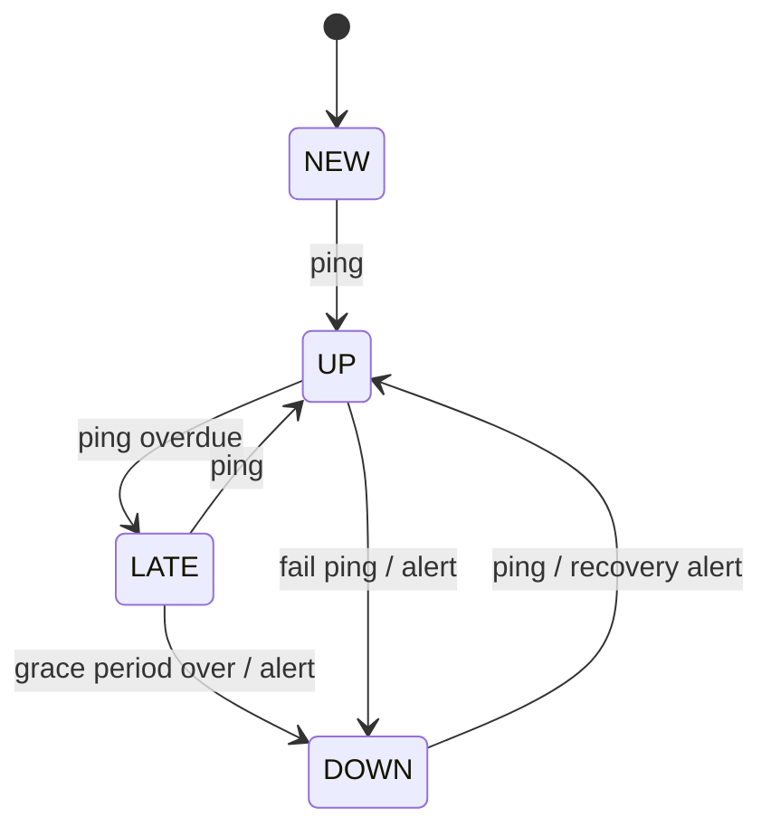

# CronPulse

**Heartbeat monitoring for cron jobs and background workers, built in public with Spring Boot.**

CronPulse tells you when a scheduled job **didn't run, ran late, or failed**. Your job pings a unique URL when it finishes. If the ping doesn't arrive on time, CronPulse alerts you by email, Slack or webhook, and tells you again when the job recovers.

```bash
# add one line to the end of your cron job
0 2 * * * /opt/scripts/backup.sh && curl -fsS -m 10 --retry 3 https://<your-host>/ping/<check-uuid>
```

Spring Boot apps don't even need that curl line:

```java
@Scheduled(cron = "0 0 2 * * *")
@CronPulse("nightly-db-backup")
public void backup() { ... }
```

> **This is a learning project first.** It is built phase by phase. Each phase ships working software and becomes one story in the Medium series **_Building CronPulse: An Enterprise-Grade Heartbeat Monitor in Spring Boot_**. Deeper material lives on [codefarm.in](https://codefarm.in).

---

## What is a heartbeat monitor?

Most monitoring alerts when something **happens**: an error, a spike, a crash. But a cron job that silently stops running produces no error at all. Nothing happens, and nobody notices until the backup you need doesn't exist.

A heartbeat monitor (also called a **dead man's switch**) flips the logic: it alerts on the **absence** of a signal. Every check has a schedule and a grace period; if the expected ping doesn't arrive, that silence is the alert.



## Built for scale

CronPulse is designed as if real companies depend on it: multi-tenant from the first migration, horizontally scalable, and observable. The working targets are **100k checks**, **2,000 pings/s sustained** with **10,000/s bursts** at the top of the hour, **p99 < 50 ms** ingest latency, and DOWN detection within **60 s**. See the [roadmap](docs/planning/ROADMAP.md#2-what-enterprise-grade-means-here) for the full list of non-functional requirements.

**Stack:** Java 21+, Spring Boot, Spring MVC (REST API + Thymeleaf UI), PostgreSQL + Flyway, ShedLock / `SKIP LOCKED`, Redis (rate limits, from Phase 5), Micrometer + OpenTelemetry → [OpenObserve](https://openobserve.ai/) (logs, metrics, traces, dashboards), Docker, Testcontainers, WireMock, k6.

---

## The phases

CronPulse is built in **5 phases, each one a complete Medium story**. Every phase ends with green tests, a git tag (`phase-1` … `phase-5`) you can check out, and a published story.
Full steps, Definition of Done and story outlines: **[docs/planning/ROADMAP.md](docs/planning/ROADMAP.md)**.

| # | Phase | Learning takeaway | Story | Status |
|---|---|---|---|---|
| 1 | Foundations: repo, data model and REST API | Some decisions are cheap on day one and very expensive later | — | 🔜 Next |
| 2 | The heartbeat engine: pings, schedules and detection | Alert on the *absence* of a signal: the dead man's switch | — | Planned |
| 3 | Observability and reliable alerts | You can't make delivery reliable if you can't see it | — | Planned |
| 4 | The product: UI, starter and multi-tenant security | One service layer, many front doors, and tenants that never see each other | — | Planned |
| 5 | Enterprise scale and production readiness | Measure, fix one bottleneck, measure again, and make deploys boring | — | Planned |

### Phase 1: Foundations: repo, data model and REST API
A repo a team could work in from day one (Gradle multi-module, Docker Compose, Dockerfile, CI, ADRs), a Flyway-managed Postgres schema that is multi-tenant from the first migration, and a versioned `/api/v1` for managing checks with `ProblemDetail` errors, pagination, idempotency keys, optimistic locking and OpenAPI docs.
**You'll learn:** what a heartbeat monitor is; which schema choices are nearly impossible to change later (tenant column, IDs, `timestamptz`); testing against real Postgres with Testcontainers; designing an API that survives client retries and concurrent edits.

### Phase 2: The heartbeat engine: pings, schedules and detection
The high-volume `/ping/{uuid}` endpoint (body cap, rate limiting, caching, virtual threads, first k6 baseline), simple and cron schedules in any time zone with an injected `Clock`, an explicit NEW → UP → LATE → DOWN state machine, and a detector that every instance can safely run at once.
**You'll learn:** the dead man's switch end to end; making a hot path do almost nothing; what daylight saving does to a 2 a.m. cron job; ShedLock vs `SELECT … FOR UPDATE SKIP LOCKED`; jobs that are safe to run twice.

### Phase 3: Observability and reliable alerts
First, logs, metrics and traces are exported over OpenTelemetry to **[OpenObserve](https://openobserve.ai/)**, with dashboards as code and secrets redacted. Then email, Slack and webhook alerts go through a transactional outbox (retries, back-off with jitter, signed webhooks, SSRF protection), watched live in OpenObserve and with SLO alerts on CronPulse itself.
**You'll learn:** linking logs, metrics and traces by `trace_id`; instrumenting once with OpenTelemetry and choosing the backend separately; at-least-once delivery without a message broker; monitoring the monitor.

### Phase 4: The product: UI, starter and multi-tenant security
The Thymeleaf UI built from the mocks in [`docs/ui/`](docs/ui/) (dashboard, check form, check detail with uptime, channels), the `@CronPulse` Spring Boot starter, and real security: logins, organisations and roles, hashed and scoped API keys, tenant isolation proven by tests, an audit log, and plan limits.
**You'll learn:** a full UI without a JavaScript framework; how Spring Boot auto-configuration works and why a library must never break its host; authentication vs authorisation vs tenancy; storing API keys safely.

### Phase 5: Enterprise scale and production readiness
Several instances behind a load balancer, time-partitioned ping storage, Redis-backed rate limiting, and k6 burst tests measured in OpenObserve. Then hardened images, graceful shutdown, zero-downtime migrations, Kubernetes manifests, CI/CD, backups and runbooks.
**You'll learn:** a measure → fix → measure loop; why partitioning makes retention cheap; expand/contract migrations; how to make deploys and failures boring.

---

## Run it locally

> Available from Phase 1. The only prerequisites are **a JDK (21+) and Docker**.

```bash
./gradlew :app:bootRun              # starts Postgres + Mailpit in Docker automatically
docker compose --profile app up     # or run the whole stack in containers
```

Ports can be changed in `.env` (copy `.env.example`). If 8080 is taken, run with `SERVER_PORT=8081 ./gradlew :app:bootRun` or set `APP_PORT` for Docker.

| Service | URL |
|---|---|
| App / UI | http://localhost:8080 |
| Swagger UI (Phase 1+) | http://localhost:8080/swagger-ui.html |
| Mailpit (caught emails) | http://localhost:8025 |
| PostgreSQL | `localhost:15432`, db/user `cronpulse` (password from `.env`, default `cronpulse`) |
| OpenObserve: logs, metrics, traces (Phase 3+, `--profile observability`) | http://localhost:5080 |

## Repository layout

```
app/                              # the CronPulse service
cron-pulse-spring-boot-starter/   # client library (Phase 4)
samples/                          # sample apps using the starter
load/                             # k6 load tests
docs/
  planning/ROADMAP.md             # phase plan, scale targets, publishing plan
  learnings/                      # one note per phase → Medium story
  adr/                            # architecture decision records
  ui/                             # UI mock designs
CLAUDE.md                         # build brief: architecture, behaviour, rules
```

## Follow along
- Medium series: *Building CronPulse: An Enterprise-Grade Heartbeat Monitor in Spring Boot* (links added as stories are published)
- Deeper material: [codefarm.in](https://codefarm.in)
