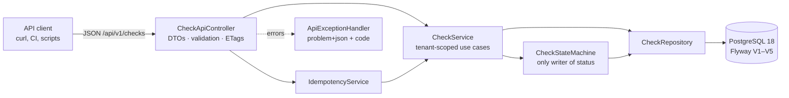

# Phase 1: Foundations: repo, data model and REST API

> Medium draft for **Building CronPulse: An Enterprise-Grade Heartbeat Monitor in Spring Boot**, Part 1.
> Working title: *Who Watches the Cron Jobs? Laying Enterprise Foundations for a Heartbeat Monitor in Spring Boot*
> Code at this point: `git checkout phase-1`

**Status:** Draft

## Hook

A nightly database backup runs at 2 a.m. One day the server's disk fills up, the cron daemon quietly stops starting it, and nothing complains. No error, no stack trace, no alert. Six weeks later someone needs a restore and finds that the newest backup is six weeks old.

Most monitoring alerts when something *happens*. The hardest failure to catch is when **nothing happens**. A heartbeat monitor (a "dead man's switch") turns that around: every job pings a URL when it finishes, and silence becomes the alert.

This series builds one, CronPulse, from an empty folder to a multi-tenant service handling thousands of pings per second. Part 1 is about the decisions that are cheap on day one and very expensive later.

## What we built

- A standard Spring Boot project (Spring Boot 4.1, Java 25, one `build.gradle`) that a team could work in on day one: Docker Compose for Postgres and Mailpit, a layered non-root Docker image, and CI
- A Flyway-managed Postgres schema that is **multi-tenant from the first migration**
- A versioned REST API for checks with RFC 9457 errors, pagination, **idempotency keys** and **optimistic locking**, documented with OpenAPI
- 40 tests, all against a real Postgres via Testcontainers



### 1.1 A repo a team can work in from day one

Fresh clone, a JDK and Docker, one command:

```bash
./gradlew bootRun   # Spring Boot starts Postgres + Mailpit from compose.yaml
```

Spring Boot's Docker Compose support reads `compose.yaml`, starts the services, and connects the datasource to them. Nothing to install, no README steps to forget. The same file has an `app` profile, so `docker compose --profile app up` runs everything in containers.

Design points worth calling out:
- **Keep the build boring:** one `build.gradle` in the standard Spring Boot layout. Spring's BOM manages almost every version; the few it doesn't (springdoc) are pinned in one `ext { }` block. We started with a multi-module Kotlin DSL build and a version catalog, and removed them: for a single service they were structure without benefit. The starter library gets its own repository in Phase 4.
- **Layered, non-root image:** dependencies go in their own layer, so a code change rebuilds only a few kilobytes of the image, and the process doesn't run as root.
- **Structured logs from day one:** containers log ECS JSON (one event per line), and local runs stay human-readable. Phase 3 only has to *ship* these logs, not retrofit them.

### 1.2 The schema: three decisions you can't easily undo

**1. The tenant column exists before login does.** Every top-level table (`checks`, `alert_channels`) has `organization_id NOT NULL`. Login arrives in Phase 4, but adding a tenant column to a 200-million-row table later is a migration nobody wants to run. Child rows (`pings`, `status_changes`) don't repeat it: they are only ever read *through* a check that was already tenant-checked. ([ADR 0002](../adr/0002-tenancy-and-ids.md))

**2. Two IDs per resource.** An internal `bigint` for joins and foreign keys, and a random `public_id` UUID that is the *only* ID the API exposes. Sequential IDs leak how many customers you have and invite enumeration (`/checks/1`, `/checks/2`, …).

**3. The ping UUID is a capability, not an ID.** Whoever knows it can report on a job. So it's separate from `public_id`, can be rotated on its own, and never appears in management URLs.

The database enforces rules, not just the code:

```sql
-- A schedule is a period OR a cron expression, never both, never neither.
CONSTRAINT checks_schedule_consistent CHECK (
    (schedule_type = 'SIMPLE' AND period_seconds IS NOT NULL AND cron_expression IS NULL)
    OR
    (schedule_type = 'CRON' AND cron_expression IS NOT NULL AND period_seconds IS NULL)
)
```

And one index is designed for the detector we build in Phase 2:

```sql
-- Only UP and LATE checks can become overdue, so only they are indexed.
CREATE INDEX checks_due_idx ON checks (next_expected_at) WHERE status IN ('UP', 'LATE');
```

### 1.3 An API that survives retries and concurrent edits

**Errors have one shape.** Every error, including Spring's own 405s and malformed JSON, is `application/problem+json` with a stable `code` that clients can branch on:

```json
{
  "status": 400, "title": "Bad Request", "code": "VALIDATION_FAILED",
  "detail": "The request has invalid fields.",
  "errors": [{ "field": "schedule.cron", "message": "Use a 5-field cron expression, e.g. '0 2 * * *'." }]
}
```

**Retries don't create duplicates.** A client creates a check, the network times out, and the client retries. Without protection you now have two checks. With an `Idempotency-Key` header, the second request replays the first response.

The trick is to insert the key in the **same transaction** as the work:

```java
int inserted = jdbc.sql("""
        INSERT INTO idempotency_keys (organization_id, idempotency_key, request_hash, created_at)
        VALUES (?, ?, ?, ?)
        ON CONFLICT DO NOTHING
        """)...update();

if (inserted == 0) {
    return replay(organizationId, key, requestHash);   // someone already did this
}
var response = action.get();                          // create the check
// ...store the response on the key row, commit everything together
```

If two requests with the same key arrive at the same moment, the second `INSERT` **waits** on the first transaction's uncommitted row. If the first commits, the second replays its response. If the first fails, its key disappears with the rollback and the second just does the work. A test fires eight concurrent requests with one key and asserts exactly one check exists.

**Concurrent edits don't silently overwrite each other.** `GET` returns `ETag: "3"` (the JPA `@Version`). `PUT` with `If-Match: "3"` fails with `412` if someone changed the check since. Without this, the last writer silently wins.

**Tenant isolation is tested, not assumed.** Every repository method a user can reach takes `organizationId`. A test creates a check in another organisation and asserts that `GET` and `DELETE` return `404`, not `403`, so the API doesn't even confirm the check exists.

## What went wrong

1. **A health check passed when our app wasn't running.** `curl localhost:8080/actuator/health` returned `UP` while CronPulse was still pulling Docker images. Another Java app on the machine was already on 8080, and another project's Postgres was on 5432. *Lesson:* know which process answered. CronPulse now defaults to host port 15432 for Postgres, and every port is configurable in `.env`.
2. **`TestRestTemplate` broke on Spring Boot 4.** `NoClassDefFoundError: RestTemplateBuilder`. In Boot 4 it moved into a separate module. We switched to `MockMvcTester`, which needs no HTTP client and has AssertJ-style assertions.
3. **A 405 came back with an empty body.** Our error handler was scoped to `@RestController`s, but a 405 happens *before* Spring picks a controller, so the handler never ran. Removing the scope fixed it; the Phase 4 UI will add its own advice.
4. **Every validation error said `"field": "request"`.** One handler had a constraint on a header (`@Size` on `Idempotency-Key`). That switches Spring 7 to *method* validation, which reports body errors under the parameter name. The handler now unwraps the real field path (`schedule.cron`).
5. **HQL silently turned off the tag filter.** This was the scary one:
   - A null filter parameter was bound as `bytea`, which Postgres can't compare with `text[]`.
   - Hibernate's `array_contains` assumed the column was `varchar[]`.
   - Calling `function('array_position', …)` was *rewritten* by Hibernate into `coalesce(array_position(...), 0) is not null`, which is **always true**. The filter would have quietly returned every check.

   The search is now plain native SQL with explicit casts. *Lesson:* for anything Postgres-specific, write the SQL yourself, and have a test that would fail if a filter stopped filtering.
6. **A search for "50%" matched "500 jobs".** `%` and `_` are wildcards in `LIKE`. Search input is now escaped. (A test bug hid this for a minute: MockMvc's URI template double-encoded `%25`.)
7. **`check` is a reserved word in SQL.** Tables are plural.

## Trade-offs

- **No tenant column on pings.** It saves space and index size on the biggest table. The cost: queries must always go through the check. If we ever needed cross-tenant ping analytics, we'd add it then.
- **`If-Match` is optional.** Requiring it (428 if missing) is stricter but unfriendly for simple scripts. `@Version` still catches true races at commit time (`409 CONCURRENT_MODIFICATION`).
- **Idempotency replays don't include the ETag.** We store status, body and `Location`. Clients that need the ETag can `GET` the resource.
- **A default organisation stands in for login.** It is one class (`DefaultOrganizationTenantResolver`) behind one interface (`TenantResolver`), so Phase 4 replaces it without touching controllers or services.
- **Tables for later features don't exist yet.** The outbox, API keys and audit log arrive with their phases, each in its own migration, so the schema history reads like the story.

## Numbers

Machine: Apple M4 Pro, 24 GB RAM, macOS 15.7.3; Postgres 18 in Docker (12 CPUs, 7.7 GB). Script: [`sql/phase-1-explain.sql`](sql/phase-1-explain.sql) (loads 100k checks + 1M pings in a transaction, then rolls back).

| Query | Plan | Execution time |
|---|---|---|
| Detector: 100 overdue UP/LATE checks | Index Scan on `checks_due_idx` (partial) | 0.41 ms |
| Ping log: newest pings for one check | Index Scan on `pings_check_received_idx` | 0.70 ms |
| Ping ingest: check by `ping_uuid` | Index Scan on `checks_ping_uuid_key` | 0.13 ms |

| Index (100k checks) | Size |
|---|---|
| `checks_ping_uuid_key` (all rows) | 4,280 kB |
| `checks_due_idx` (partial: UP/LATE only) | 888 kB |

The partial index is ~5× smaller because NEW, DOWN and PAUSED checks never enter it. It stays small however many checks are paused or down.

## Try it yourself

```bash
git checkout phase-1
./gradlew bootRun                           # dev profile: seeded demo data
curl -s localhost:8080/api/v1/checks/summary
# {"total":6,"byStatus":{"NEW":1,"UP":2,"LATE":1,"DOWN":1,"PAUSED":1}}

curl -s -X POST localhost:8080/api/v1/checks \
  -H 'Content-Type: application/json' -H 'Idempotency-Key: my-first-check' \
  -d '{"name":"Nightly backup","schedule":{"type":"CRON","cron":"0 2 * * *","timeZone":"Asia/Kolkata"},"graceSeconds":900}'
# run it again: same 201, plus "Idempotent-Replayed: true"

open http://localhost:8080/swagger-ui.html
```

## Next in the series

We can create checks, but nothing pings them yet and nothing notices silence. Part 2 builds the heartbeat engine: a ping endpoint designed for thousands of requests per second, cron schedules across time zones and daylight saving, and a detector that runs on every instance without double-processing. Deeper material: [codefarm.in](https://codefarm.in).
