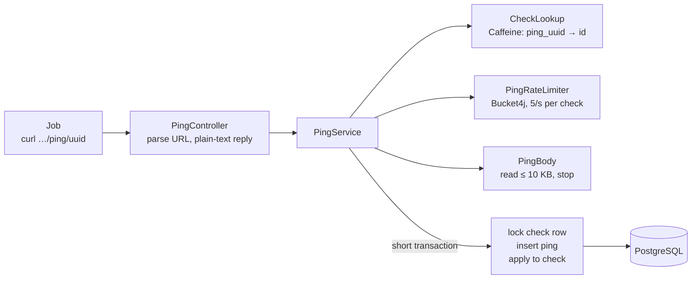

# Phase 2: The heartbeat engine: pings, schedules and detection

> Medium draft for **Building CronPulse: An Enterprise-Grade Heartbeat Monitor in Spring Boot**, Part 2.
> Working title: *Building a Dead Man's Switch: High-Volume Pings, Cron Time Zones and a Detector That Runs Everywhere*
> Code at this point: `git checkout phase-2`

**Status:** Draft (step 2.1 written; 2.2 and 2.3 in progress)

## Hook

Monitoring that waits for an error never fires when a job doesn't run at all. A crashed cron daemon, a deleted crontab line or a container that never started produce no error and no stack trace. Nothing happens, and nothing tells you.

A dead man's switch flips this around. Every job says "I'm alive" when it finishes, and **silence** becomes the alarm. To make that work you need three things: an endpoint that can take a ping from every job you own without falling over, a precise idea of *when* the next ping is due (time zones and daylight saving included), and something that notices when it doesn't arrive, even when you run several copies of the service.

## What we built

- **2.1** The ping endpoint: `/ping/{uuid}` plus `/start`, `/fail` and `/{exitCode}`, on GET, POST and HEAD. Bounded input, an in-memory rate limit, a cached lookup, and a database connection held only for the write
- **2.2** *(in progress)* Schedules: simple periods and cron expressions in any IANA time zone, DST included, plus a preview API
- **2.3** *(in progress)* The state machine and a detector that runs on every instance with `SKIP LOCKED`



### 2.1 The hot path: do almost nothing, in the right order

Every job you monitor calls this endpoint, often all at the same moment (the top of the hour). The design rule is: **cheap rejections first, and hold the database connection for as short a time as possible.**

```java
public PingOutcome record(UUID pingUuid, PingSignal signal, PingSource source, InputStream body) throws IOException {
    var receivedAt = clock.instant();
    var checkId = lookup.checkIdFor(pingUuid);            // usually cached: no database
    if (checkId.isEmpty()) {
        return new PingOutcome.UnknownCheck();            // 404
    }
    var decision = rateLimiter.tryAcquire(checkId.get()); // in memory: no database
    if (!decision.allowed()) {
        return new PingOutcome.RateLimited(decision.retryAfter()); // 429 + Retry-After
    }
    var output = PingBody.read(body);                     // network I/O, still no database
    return transaction.execute(status -> save(...));      // the only part that holds a connection
}
```

Points worth calling out:

- **Not `@Transactional` on the class.** A class-level transaction would take a connection at the start of the method and hold it while a slow client uploads its output. With 10 connections in the pool, ten slow uploads would block every other ping. `TransactionTemplate` wraps only the writes.
- **The body is capped while reading, not after.** `in.readNBytes(MAX_BYTES + 1)` reads at most 10 KB plus one byte to know whether anything was cut. A job that pipes a 2 GB log into curl costs 10 KB of memory. In the smoke test, a 4 MB upload was answered in 10 ms with exactly 10,240 bytes stored.
- **Cutting bytes is harder than it looks.** Cutting a UTF-8 byte array at byte 10,240 can split a multi-byte character. Invalid bytes decode to U+FFFD, which is *3* bytes when encoded again, so the text can grow past the limit. Postgres `text` also rejects NUL characters, which binary output contains. `PingBody` handles all three, and the database has `CHECK (octet_length(body) <= 10240)` as the backstop.
- **The cache holds an id, never state.** `CheckLookup` caches `ping_uuid → check id`. The ping is still applied to a freshly loaded, locked row, so a cached entry can't make us act on stale data. A deleted check is evicted after the delete commits (`@TransactionalEventListener`); another instance that still has the id cached finds the locked load empty, evicts it and answers 404.
- **Unknown UUIDs are not cached.** A flood of random UUIDs would fill the cache with entries nobody uses again. Stopping that is a job for a per-IP limit at the edge (Phase 5).
- **Rate limiting per check, with the app's own clock.** Bucket4j gives each check a token bucket of 5 that refills at 5 per second. Its time source is our injected `Clock`, so tests check "the 6th ping in the same instant is rejected, and 200 ms later one is allowed again" without sleeping. The limiter is behind an interface because in-memory buckets only work on one instance; Phase 5 swaps in Redis.
- **Pings for one check are applied one at a time.** The write loads the check with `SELECT … FOR UPDATE`, so two concurrent pings can't both read the old state and overwrite each other. Pings for different checks lock different rows and never wait for each other.
- **Responses are tiny plain text.** `OK`, `Not found`, `Rate limit exceeded`. The client is curl in a shell script; the status code is what matters.
- **Duration tracking** uses `last_start_at`: a SUCCESS or FAIL ping measures the time since the last START, as long as that START hasn't already been closed. The result is clamped at zero because instances' clocks can differ by a few milliseconds.

## The key concept

*To be written when 2.3 is done: alerting on the absence of a signal, end to end.*

## What went wrong

- **Every ping would have broken the API's optimistic locking.** `Check` has a `@Version`, exposed as the ETag. The first draft of the ping path updated `last_ping_at` through the entity, which bumped the version on every ping. A user who fetched a check, waited a minute and saved would get `412 Precondition Failed` because their job had pinged in between. The ETag is meant to protect *user edits*, not machine-written runtime fields. **Fix:** `@OptimisticLock(excluded = true)` on the ping times, plus `@DynamicUpdate` so Hibernate writes only changed columns; without it, a user's edit would write back the old `last_ping_at` it had loaded. A test now checks that a ping leaves the ETag unchanged. **Lesson:** decide what a version number *means* before more than one writer touches the row.
- **The Docker image wouldn't start after `bootRun`.** `./gradlew bootRun` (dev profile) applies the repeatable `R__dev_seed.sql` to the shared compose database. The `app` container runs without the dev profile, can't see that file, and Flyway refused to start: *"Detected applied migration not resolved locally: dev seed"*. This had been broken since Phase 1, and nobody noticed until the containerised app ran against a database the dev run had used. **Fix:** `spring.flyway.ignore-migration-patterns: "*:future,repeatable:missing"`. Only repeatable migrations are excused; versioned ones are still validated strictly. **Lesson:** run the production artifact against a realistic database, not just a fresh one.
- **A test that tested nothing.** The first "oversized body" unit test used `new byte[1024 * 1024]`, a megabyte of zero bytes. `PingBody` correctly strips NULs, so the stored text was empty and the assertion failed. The code was right and the test was wrong. **Lesson:** test inputs should look like real input.
- **k6 has no `URL` class.** The first baseline run died in `setup()` on `new URL(...)` and left 50 checks behind (teardown doesn't run when setup fails). A regex replaces it, and the leftovers were deleted by hand.

## Trade-offs

- **Pessimistic row lock per ping vs. a blind `UPDATE`.** Locking serialises pings for *one* check, which is fine: a check is limited to 5 pings per second. It gives the state machine (2.3) a consistent row to reason about. A single `UPDATE … SET last_ping_at = …` would be one round trip fewer, but it can't express "if DOWN, then UP and queue a recovery alert".
- **In-memory rate limits.** With N instances a check can send N × 5 pings per second. That's acceptable until Phase 5 adds Redis-backed buckets behind the same interface.
- **Trusted proxies.** `server.forward-headers-strategy: native` lets Tomcat take the client IP from `X-Forwarded-For`, but only from a trusted internal proxy. Tomcat's default list trusts every private-range address. In the smoke test, the Docker Desktop gateway (192.168.65.1) could therefore set any source IP. The IP is only shown in the ping log, not used for auth or limits, so we keep the default for now. Phase 5 pins `server.tomcat.remoteip.internal-proxies` to the load balancer.
- **No cap on duration.** A START whose job dies silently, followed a day later by a SUCCESS, records a duration of a day. Healthchecks-style caps are possible; we keep the rule simple and visible.

## Numbers

**k6 baseline, step 2.1** (`load/ping-baseline.js`, constant arrival rate, 60 s, 2,000 checks, a random check per request, GET with no body)

Machine: Apple M4 Pro (12 cores, 24 GB), macOS 15.7, Docker Desktop 28.3 with 12 CPUs and 8 GB for the VM. The app (1 container, default JVM settings, Hikari pool of 10), Postgres 18 and k6 all run on the same machine, so they compete for CPU.

| Target rate | Achieved | p50 | p95 | p99 | max | Errors |
|---|---|---|---|---|---|---|
| 1,000/s (cold JVM) | 959/s | 0.91 ms | 3.72 ms | 42.9 ms | 221 ms | 0 |
| 1,000/s (warm) | 976/s | 0.91 ms | 2.49 ms | **12.1 ms** | 124 ms | 0 |
| 2,000/s | 1,819/s | 1.38 ms | 266 ms | 982 ms | 3.8 s | 0 |
| 3,000/s | 2,318/s | 26 ms | 1.28 s | 2.62 s | 6.5 s | 0 (15 × 429) |

The scale target (ROADMAP §2.1: ≥ 1,000 pings/s per instance, p99 < 50 ms) is met at 1,000/s once the JVM is warm. The knee is between 1,000 and 2,000/s.

**Where it saturates.** At 2,000/s the app used about 1.7 of 12 cores and Postgres about 1. CPU was not the limit. All 10 pool connections were busy, mostly waiting on `WALWrite` / `WalSync`. Every ping is its own transaction with four round trips (lock, insert, update, commit), and every commit waits for a WAL flush. So the bottleneck is *connections × commit latency*: about 1,800 pings/s ÷ 10 connections ≈ 5.5 ms per transaction. That is the starting point for Phase 5 (pool sizing, fewer round trips, batching, partitioned pings). Overloaded, the service slowed down but never failed a request.

## Try it yourself

```bash
git checkout phase-2
./gradlew bootRun

# create a check, then ping it
curl -s -X POST localhost:8080/api/v1/checks -H 'Content-Type: application/json' \
  -d '{"name":"demo","schedule":{"type":"SIMPLE","periodSeconds":3600},"graceSeconds":300}'
curl -d "backup ok" http://localhost:8080/ping/<uuid>        # success, with output
curl http://localhost:8080/ping/<uuid>/start                  # job started
curl http://localhost:8080/ping/<uuid>/$?                     # exit code: 0 = success

# the load baseline
docker compose --profile app up -d --build
docker compose --profile load run --rm k6 run /load/ping-baseline.js
```

## Next in the series

*To be written at the end of the phase: Phase 3, telling someone (observability first, then the outbox).*
