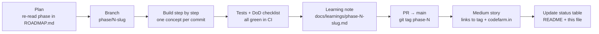
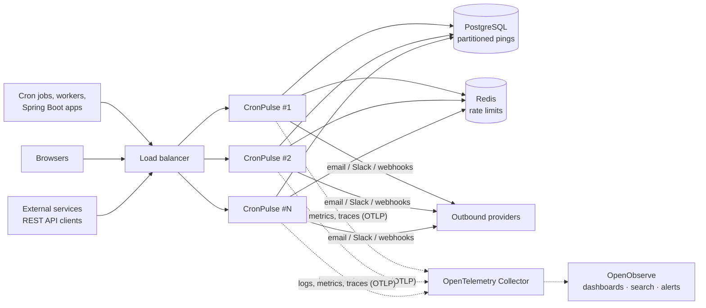
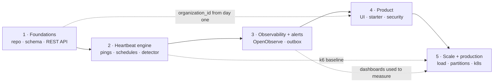
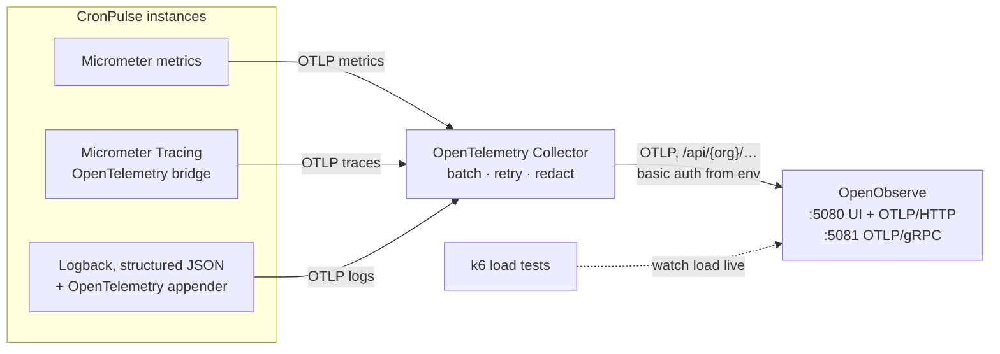

# CronPulse: Build Plan and Story Roadmap

> The phase-by-phase plan for building CronPulse in public.
> **5 phases, 5 Medium stories.** Each phase ships working software and one complete, readable story.
> The README has the short version; this document is the detailed plan.

---

## 1. How this plan works

CronPulse is built in **5 phases**. Each phase is big enough to make a complete story, and small enough to finish:

1. **Ships something that runs.** At the end of every phase, `main` builds, all tests pass, and the app starts in Docker.
2. **Has one headline takeaway.** The story is built around it; the phase's steps become the story's sections.
3. **Becomes one Medium story.** The learning note (`docs/learnings/phase-N-<slug>.md`) is the first draft. Aim for a 12–18 minute read; deeper dives go to [codefarm.in](https://codefarm.in).
4. **Is tagged in git** (`phase-1` … `phase-5`) so readers can check out the code as it was when the story was written.

Inside a phase, work is split into **steps** (e.g. 2.1, 2.2). Each step is a few focused commits and one section of the story. Steps are checkpoints, not separate stories.

### Phase workflow

### Rules for every phase
- **Don't start the next phase until the current one meets its Definition of Done.**
- Record decisions with real trade-offs as short ADRs in `docs/adr/NNNN-title.md` (context, decision, consequences). Stories link to them.
- Record mistakes as they happen (a scratch "what went wrong" list in the learning note). They are the most valuable part of each story.
- Measure before you claim. Any performance claim in a story must come from a k6 run or an OpenObserve dashboard backed by checked-in config.

---

## 2. What "enterprise grade" means here

CronPulse is a learning project, but it is designed as if real companies will depend on it. Concretely:

### 2.1 Scale targets (working numbers; verified in Phase 5)

| Dimension | Target |
|---|---|
| Active checks | 100,000 across all tenants |
| Tenants (organisations) | 10,000 |
| Ping ingest, sustained | 2,000 pings/s across the cluster; ≥ 1,000 pings/s per instance |
| Ping ingest, burst | 10,000 pings/s for 60 s (everything fires at `0 * * * *`) |
| Ping latency (server side) | p99 < 50 ms at sustained load |
| Detection lag | A check is marked DOWN ≤ 60 s after `nextExpectedAt + grace` |
| Alert delivery | p95 < 60 s from DOWN transition to first delivery attempt |
| Ping history | ~200 M rows/month before retention; queries stay fast regardless |
| Availability | 99.9% for ping ingest (ingest is what users' jobs depend on) |

> **Why the burst matters:** cron schedules cluster on the hour and half hour. A heartbeat monitor's real load is spiky, not flat. This one fact shapes the ingest path, the rate limiter, and the database design.

### 2.2 Non-functional requirements

| Area | Requirement | Phase |
|---|---|---|
| Multi-tenancy | Every row belongs to an organisation from the first migration. Tenant isolation is enforced in the service layer and proven by tests. | 1, 4 |
| Horizontal scale | The app is stateless; any number of instances can run behind a load balancer. Background jobs are safe to run on every instance. | 2, 5 |
| Security | Login for the UI, hashed and scoped API keys, unguessable ping IDs, SSRF protection and signatures on webhooks, OWASP headers, dependency and image scanning. | 3, 4, 5 |
| Reliability | At-least-once alert delivery (outbox), idempotent jobs, graceful shutdown, zero-downtime migrations. | 2, 3, 5 |
| Observability | Logs, metrics and traces exported over OpenTelemetry (OTLP) to **OpenObserve**, with dashboards, alerts and SLOs. Structured JSON logs with trace IDs. | 3 → 5 |
| Auditability | Audit log of who changed what (checks, channels, API keys, members). | 4 |
| Data lifecycle | Partitioned ping storage, retention by plan, `StatusChange` kept 90 days. | 5 |
| API stability | Versioned (`/api/v1`), documented (OpenAPI), idempotent creates, optimistic locking, consistent errors. | 1 |
| Delivery | CI on every PR, container images built and scanned, deployable to Kubernetes with health probes. | 1, 5 |
| Testability | Time is injected (`Clock`); every external call is behind an interface; real Postgres in tests. | all |

### 2.3 Target architecture at scale

Every instance runs the same code: web traffic, the detector and the outbox sender. Work is shared between instances with `SELECT … FOR UPDATE SKIP LOCKED`, not by electing a single leader. Phase 2 explains this choice.

---

## 3. Phase overview

| # | Phase | Headline takeaway | Medium story (working title) | Status |
|---|---|---|---|---|
| 1 | Foundations: repo, data model and REST API | Some decisions are cheap on day one and very expensive later: make them now | Who Watches the Cron Jobs? Laying Enterprise Foundations for a Heartbeat Monitor in Spring Boot | ✅ Built · story in draft |
| 2 | The heartbeat engine: pings, schedules and detection | Alert on the *absence* of a signal: building a dead man's switch | Building a Dead Man's Switch: High-Volume Pings, Cron Time Zones and a Detector That Runs Everywhere | 🔜 Next |
| 3 | Observability and reliable alerts | You can't make delivery reliable if you can't see it | Reliable Alerts You Can See: The Transactional Outbox, Observed with OpenTelemetry and OpenObserve | Planned |
| 4 | The product: UI, starter and multi-tenant security | One service layer, many front doors, and tenants that never see each other | From Service to Product: Thymeleaf UI, a Spring Boot Starter and Multi-Tenant Security | Planned |
| 5 | Enterprise scale and production readiness | Measure, find the bottleneck, fix one thing, and make deploys boring | From 300 to 3,000 Requests per Second: Scaling and Shipping a Spring Boot Service to Production | Planned |

**Medium series name:** *Building CronPulse: An Enterprise-Grade Heartbeat Monitor in Spring Boot*

**Usable-product checkpoints:**
- After **Phase 2**, pings are recorded and missing jobs are detected (status changes are visible through the API).
- After **Phase 3**, CronPulse works end to end through the API: create a check, ping it, get alerted when it goes quiet, and watch it all in OpenObserve.
- After **Phase 4**, it is a complete multi-tenant product with a UI, logins and the starter.
- After **Phase 5**, it is proven at scale and ready for production.

---

## 4. Phase details

Each phase lists its **Goal**, **Steps**, **Definition of Done (DoD)**, **Learning takeaways** and a **Story outline**.

---

### Phase 1: Foundations: repo, data model and REST API

**Goal:** a repository a team could work in from day one, with a schema built for multi-tenancy and scale, and a versioned REST API for managing checks.

**Step 1.1: Project and delivery setup**
- Standard single-module Spring Boot project: `build.gradle` (Groovy DSL), `settings.gradle`, `src/main/java`, `src/test/java`; non-BOM versions pinned in `build.gradle`
- `compose.yaml`: Postgres + Mailpit; Spring Boot Docker Compose support
- Multi-stage `Dockerfile`; `docker compose --profile app up` runs the full stack
- GitHub Actions: build + test on every PR (Testcontainers in CI)
- Structured JSON logging from day one (Spring Boot structured logging), so Phase 3 only has to ship the logs
- `.editorconfig`, `.gitignore`, `.env.example`, `docs/adr/0001-record-architecture-decisions.md`

**Step 1.2: Data model for scale**
- Flyway migrations, one concept each, for the core tables in `CLAUDE.md` §8: tenancy (`organizations`, `app_users`, `memberships`), `checks`, ping history, alert channels. **Every top-level tenant-owned table has `organization_id`**, even though login comes in Phase 4. Tables for later features (outbox, API keys, audit) arrive with their phase.
- Internal `bigint` identity primary keys; external `public_id` (random UUID); `ping_uuid` separate and secret
- All instants `timestamptz`; enums as `text` with `CHECK` constraints; indexes backed by `EXPLAIN`
- JPA entities and repositories per feature package; Testcontainers repository tests; dev seed data (profile `dev`)

**Step 1.3: REST API for checks**
- `/api/v1/checks` CRUD, pause/resume, summary (`CLAUDE.md` §5.7)
- Request/response records, Bean Validation, no entities in the API
- One `@RestControllerAdvice` producing `ProblemDetail` for every error
- Pagination (capped page size), filters and search
- `Idempotency-Key` on `POST`; optimistic locking via `ETag` / `If-Match` → `412`
- OpenAPI via springdoc; Swagger UI; spec exported to `docs/api/openapi.json` in CI
- Temporary "default organisation" resolver until Phase 4 (in one place, easy to replace)

**DoD**
- [x] Fresh clone → `./gradlew bootRun` works with only a JDK and Docker; `docker compose --profile app up` serves `/actuator/health` = UP
- [ ] CI is green on PRs *(workflow written and the same build passes locally; not yet run on GitHub: no remote)*
- [x] Repository tests (Testcontainers) including tenant scoping; `EXPLAIN` output for key queries in the learning note
- [x] `MockMvc` tests: happy paths, `400`, `404`, `409`, `412`, idempotent replay; OpenAPI spec checked in
- [x] Learning note written ([draft](../learnings/phase-1-foundations.md)); tag `phase-1`

**Learning takeaways**
- **Headline:** some decisions are cheap on day one and very expensive later: tenant column, ID strategy, `timestamptz`, the API contract, CI
- What a heartbeat monitor (dead man's switch) is, and the product angle (Spring Boot native)
- Flyway discipline, and Testcontainers instead of H2
- API design for teams you'll never meet: `ProblemDetail`, idempotency keys, optimistic locking, versioning

**Story outline:** the backup that silently stopped for six weeks → what we're building and the series plan → repo and Docker setup in 5 minutes → three schema decisions you can't undo → an API that survives retries and concurrent edits → what went wrong → next: making it actually detect silence.

---

### Phase 2: The heartbeat engine: pings, schedules and detection

**Goal:** jobs can ping CronPulse at high volume, and CronPulse works out when the next ping is due and notices when it doesn't arrive, on any number of instances.

**Step 2.1: Ping ingest (the hot path)**
- `GET`/`POST`/`HEAD` on `/ping/{uuid}`, `/start`, `/fail`, `/{exitCode}`
- Body capped at 10 KB (stream-limited), proxy-aware source IP, user agent, method; duration from `start`
- Virtual threads; Caffeine cache for `ping_uuid → check`
- Per-check rate limiting (Bucket4j, in-memory for now) → `429` + `Retry-After`
- **k6 baseline** in `load/` (run via Docker), results recorded

**Step 2.2: Time and schedules**
- `Clock` bean and a `MutableClock` test helper
- SIMPLE (period) and CRON (expression + IANA zone) schedules plus grace; `ScheduleCalculator` using Spring's `CronExpression`
- Human-readable descriptions; `POST /api/v1/schedules/preview`

**Step 2.3: State machine and detector**
- `CheckStateMachine`: the only code that changes `check.status`; writes `status_change` rows; pings apply transitions
- Detector every 30 s on **every instance**, claiming due checks with `SELECT … FOR UPDATE SKIP LOCKED`
- ADR: ShedLock (single runner) vs SKIP LOCKED (shared work queue); ShedLock kept for true singletons
- `GET /api/v1/checks/{id}/status-changes`; detector-lag metric (exported in Phase 3)

**DoD**
- [ ] Ping tests: unknown ID `404`, oversized body truncated, `429`, every exit code, `HEAD`
- [ ] Schedule tests: periods, cron, several zones, **DST forward and back** (`Europe/London`, `America/New_York`), month ends, leap day, invalid input
- [ ] State machine test for every transition with a fixed `Clock`
- [ ] Detector tests: running twice, and two detectors at once, never double-transition
- [ ] k6 baseline (req/s, p50/p95/p99 and machine spec) in the learning note; tag `phase-2`

**Learning takeaways**
- **Headline:** alert on the *absence* of a signal: the dead man's switch, end to end
- Make the hot path do almost nothing: bounded input, no inline alerts, rate limits, unguessable IDs
- Time is a dependency: inject `Clock`; what DST does to a 2 a.m. cron job
- One owner per state change; share scheduled work with SKIP LOCKED instead of electing a leader; jobs that are safe to run twice

**Story outline:** "nothing happened" is the hardest event to detect → designing the ping endpoint and the first k6 numbers → time zones, DST and the injected clock → the state machine → one detector, many instances, no double-processing → what went wrong → next: telling someone.

---

### Phase 3: Observability and reliable alerts

**Goal:** first make CronPulse **observable** with OpenObserve, then build alert delivery that is reliable and visible: down and recovery alerts by email, Slack and webhook, with no duplicates and no lost alerts.

> Observability comes **first** in this phase on purpose. The outbox, retries and back-off are much easier to build, debug and explain when you can watch them in dashboards and traces. It's also ready before Phase 5's load testing.

**Step 3.1: Observability with OpenTelemetry and OpenObserve**

**Backend: [OpenObserve](https://openobserve.ai/)** (open-source edition, self-hosted in Docker). One tool stores and visualises **logs, metrics and traces**, with dashboards, SQL/PromQL queries and alerts. That replaces running Prometheus + Grafana + Loki + Jaeger separately.

- Compose profile `observability`: **OpenObserve** (official OSS image, version pinned, named volume, root credentials from `.env`) + **OpenTelemetry Collector**
- App exports all three signals over **OTLP to the Collector**, never directly to OpenObserve:
  - metrics: `micrometer-registry-otlp`
  - traces: `micrometer-tracing-bridge-otel` + `opentelemetry-exporter-otlp`, sampling configurable per environment
  - logs: structured JSON to stdout plus the OpenTelemetry Logback appender, carrying `trace_id` / `span_id`
- Collector: batching, retries, and **redaction** (drop ping bodies, API keys and auth headers)
- Metrics from Phase 2: pings/s by result, `429` rate, detector lag, checks by status, DB pool usage
- **Dashboards as code:** JSON in `observability/openobserve/dashboards/`, imported by a script on startup (`Ingest`, `Detector`, `JVM & DB`)
- ADR: why OpenObserve, why the Collector in front, and the licence note

**Licence note:** the OpenObserve open-source edition is **AGPL-3.0**. Running it unmodified as our internal observability backend is fine. CronPulse doesn't link to or embed it; we only send it OTLP data. Any change to OpenObserve itself that you offer as a service would have to be published. This goes in the ADR so enterprise readers can check it with their own policy.

**Step 3.2: Alert channels and the transactional outbox**
- `Notifier` interface; `EmailNotifier`, `SlackNotifier`, `WebhookNotifier`; channels API, check ↔ channel links, test alerts
- `alert_outbox` rows written in the **same transaction** as the state change
- Sender on every instance: claims rows with SKIP LOCKED; exponential back-off **with jitter**, max 5 attempts, then FAILED
- Outbound webhooks signed with HMAC-SHA256 plus a timestamp; **SSRF protection** on targets; timeouts on every call
- Optional "remind every N hours while DOWN"

**Step 3.3: Alerting on ourselves**
- Outbox metrics (backlog, oldest-pending age, success rate by channel) added to an `Alerts` dashboard
- OpenObserve alerts for the SLOs: ingest availability, detection lag > 60 s, outbox backlog age, error-log spikes
- Meta-heartbeat: CronPulse pings an *external* monitor, because it can't alert about itself being down

**DoD**
- [ ] `docker compose --profile app --profile observability up` → logs, metrics and traces for one ping are visible in OpenObserve and linked by `trace_id`
- [ ] Dashboards load from the repo on a fresh volume
- [ ] No ping bodies or secrets in exported logs (test with a ping containing a fake secret)
- [ ] WireMock tests: success, 500 → retry → success, permanent failure → FAILED, timeout; recovery alert sent exactly once
- [ ] A broken Slack webhook appears as an outbox backlog and fires an OpenObserve alert; emails visible in Mailpit
- [ ] Tag `phase-3`

**Learning takeaways**
- **Headline:** you can't make delivery reliable if you can't see it
- Logs, metrics and traces: what each one answers, and linking them by `trace_id`
- Vendor-neutral telemetry: instrument once with OpenTelemetry, choose the backend (OpenObserve) separately
- The transactional outbox: at-least-once delivery without a message broker; why "send in the transaction" loses alerts
- Back-off with jitter; webhook security in both directions (SSRF and signatures); monitoring the monitor

**Story outline:** an alert you never received → wiring OpenTelemetry → OpenObserve in Docker → three ways to send an alert and two of them are wrong → the outbox, watched live in a trace → breaking Slack on purpose and watching retries in a dashboard → what went wrong → next: a UI and real users.

---

### Phase 4: The product: UI, starter and multi-tenant security

**Goal:** turn the service into a product: a UI from the `docs/ui/` mocks, a one-annotation Spring Boot starter, and real users, organisations and API keys with tenant isolation proven by tests.

**Step 4.1: Thymeleaf UI**
- The four screens per `CLAUDE.md` §6: dashboard, create/edit, detail, channels; layout + fragments; design tokens in `app.css`
- PRG forms, inline validation, flash messages, delete confirmation built into the page
- Small JS: copy URL, snippet tabs, live schedule preview via the API
- Uptime % per check and the 14-day timeline (calculated from `status_change`); accessibility basics

**Step 4.2: Spring Boot starter**
- New repository `cron-pulse-spring-boot-starter` (standard layout, its own build); auto-configuration, `@ConfigurationProperties`, AOP aspect for `@CronPulse`
- Async client with short timeouts and a bounded queue that drops on overload; start / success / fail
- `samples/demo-app`; starter README; publish to Maven Local

**Step 4.3: Security and multi-tenancy**
- Spring Security: session login for the UI (form login; OIDC/Google as an extension), CSRF, security headers, brute-force protection
- Organisations and roles (OWNER, ADMIN, VIEWER); tenant context per request; every query scoped by `organization_id`
- **API keys:** shown once, stored as a SHA-256 hash with a visible prefix (`cp_live_…`), scoped read/write, revocable, last-used tracking
- Starter: API key + slug auto-creates checks on first ping
- Audit log (`audit_event`); plan limits (FREE: 10 checks, 100 pings kept) and a plan flag ready for payments; opt-in public SVG status badge

**DoD**
- [ ] Each page matches its mock (screenshots in the learning note); `MockMvc` tests for pages and forms
- [ ] Starter tests: CronPulse down, slow or returning 500 → the host job is unaffected; sample app appears in the dashboard
- [ ] **Cross-tenant tests**: tenant A can never read or change tenant B's data through the UI or the API
- [ ] API key tests: valid, revoked, wrong scope, unknown
- [ ] Tag `phase-4`

**Learning takeaways**
- **Headline:** one service layer, many front doors (UI, API, starter), and tenants that never see each other
- Turning design mocks into maintainable Thymeleaf templates; progressive enhancement without a JS framework
- How Spring Boot auto-configuration works; good libraries never break their host
- Authentication vs authorisation vs tenancy; storing API keys like passwords; audit logs

**Story outline:** a service nobody can use isn't a product → from mock to template → `@CronPulse`, the one-line integration → the scariest bug in SaaS (cross-tenant leaks) and the tests that prevent it → API keys done right → what went wrong → next: proving it at scale.

---

### Phase 5: Enterprise scale and production readiness

**Goal:** meet the §2.1 targets with measurements, and make deploys, migrations and failures routine.

**Step 5.1: Scaling with measurements**
- Compose profile `scale`: 3 app instances behind nginx
- **Partition `ping` by time** (native Postgres range partitions); a ShedLock singleton creates future partitions and drops expired ones; per-check cap for plan retention
- **Distributed rate limiting** with Bucket4j + Redis (added to Compose)
- HikariCP sizing from measurements; N+1 checks; batch inserts where they help; detector batch tuning
- k6 scenarios (sustained, top-of-the-hour burst, many tenants), watched in OpenObserve and compared with the Phase 2 baseline

**Step 5.2: Production readiness**
- Container hardening: non-root, minimal base image, layered jar, SBOM, Trivy scan in CI
- Liveness/readiness probes; **graceful shutdown** (stop taking pings, finish in-flight work, release claimed rows)
- **Zero-downtime migrations** (expand → migrate → contract) with a real example
- Kubernetes manifests or a Helm chart: HPA, PodDisruptionBudget, resource limits, config/secrets; OpenObserve/Collector config for the cluster
- CI/CD: build, test, scan, push image on tag; Renovate/Dependabot; OWASP dependency check
- Backups + restore drill; runbooks ("detector stuck", "outbox backlog", "DB full") linked from OpenObserve alerts

**DoD**
- [ ] k6 meets the §2.1 ingest targets on a documented machine spec (or documents the gap honestly)
- [ ] Retention runs without long locks or table bloat
- [ ] Rolling restart under k6 load loses no pings (apart from documented, retried `5xx`s)
- [ ] Restore drill documented; ADRs for partitioning and Redis
- [ ] README "How it works" complete; tag `phase-5`

**Learning takeaways**
- **Headline:** measure, find the bottleneck, fix one thing, measure again, and make deploys boring
- Partitioning makes retention cheap (drop a partition vs `DELETE` 100M rows)
- Why in-memory rate limits break with N instances; the connection pool as the real limit
- Expand/contract migrations; what graceful shutdown means for background workers
- Series retrospective: what we'd do differently

**Story outline:** the top-of-the-hour stampede → baseline vs target → three bottlenecks and their fixes, shown with OpenObserve screenshots → partitions and Redis → rolling deploys under load → the restore drill → retrospective of the series.

---

## 5. Medium publishing plan

### Story template (each phase)
Each `docs/learnings/phase-N-<slug>.md` follows [`docs/learnings/_TEMPLATE.md`](../learnings/_TEMPLATE.md):

1. **Hook:** a real failure or question (≤ 150 words)
2. **What we built in this phase:** with a diagram
3. **One section per step:** the concept, then the code that matters (2–3 short snippets per step, linked to the tagged commit)
4. **What went wrong:** actual mistakes and how they were fixed
5. **Trade-offs:** what we chose not to do, and when you'd choose differently (link the ADRs)
6. **Try it yourself:** `git checkout phase-N` plus commands
7. **Next in the series:** a teaser for the next phase, with links to [codefarm.in](https://codefarm.in)

### Conventions
- Target a 12–18 minute read. If a step needs more depth, write a short version in the story and a deep dive on codefarm.in.
- Series name in every story's subtitle; consistent tags: `Java`, `Spring Boot`, `System Design`, `Backend`, `Software Engineering`
- Code in stories always matches the tagged commit
- Diagrams are Mermaid in the repo, exported to images for Medium; dashboards are real OpenObserve screenshots
- Each story links to the previous and next stories, the repo tag, and codefarm.in
- A phase isn't "done" in the status table until its story is published

---

## 6. Risks and how we manage them

| Risk | Mitigation |
|---|---|
| Phases are big and drag on | Steps are checkpoints with their own tests; finish one step before starting the next; new ideas go to the parking lot |
| Stories get too long | One headline per phase; each step gets one section; extra depth goes to codefarm.in |
| Enterprise features drown the learning value | Advanced extras are clearly marked optional |
| Load numbers depend on the machine | Always publish the machine spec next to the numbers; compare runs on the same machine |
| Retrofitting tenancy is painful | `organization_id` on every tenant-owned table from Phase 1 |
| Schema changes after publishing break readers' checkouts | Migrations are forward-only; tags freeze each phase's code |

## 7. Later / parking lot
Team invitations UI, SSO (SAML), PagerDuty/Opsgenie, Telegram, Maven Central publishing, multi-region deployment, payments (Razorpay), and a public status page.
